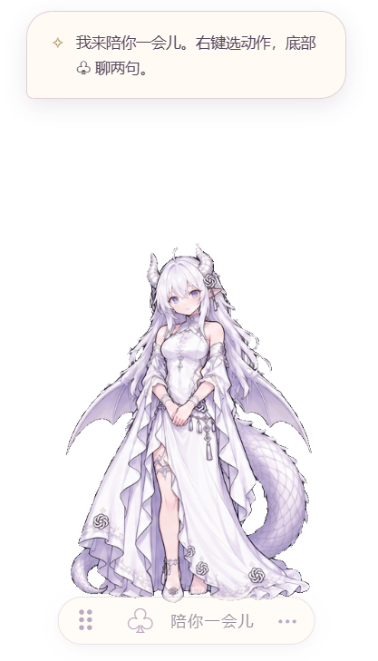
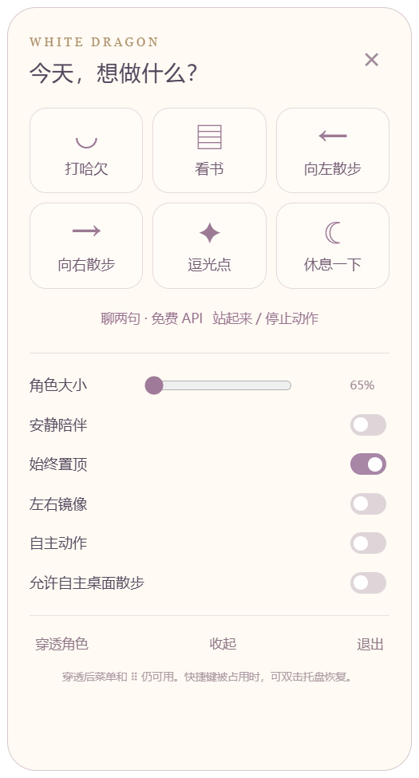

# GPT 2D Desktop Pet · 龙娘桌宠

基于 Electron 的 Windows 透明桌宠。让一位白发龙娘陪在桌面上，可以拖动、散步、看书、休息，也可以接入可选的 AI 文字对话。

> 当前版本：**v1.5.0**。本仓库以恢复后的 v1.5 为基线，不包含后续随机乱逛实验与分层动画试用版。角色为同人形象，本项目与 OpenAI 无官方关联。

## 下载即用

**[下载 Windows x64 便携版（ZIP，约 178 MiB）](https://github.com/wenmu663559/GPT-2D-desktop-pet/releases/download/v1.5.0/GPT-2D-Desktop-Pet-v1.5.0-Windows-x64.zip)** · [版本说明与全部附件](https://github.com/wenmu663559/GPT-2D-desktop-pet/releases/tag/v1.5.0)

1. 下载上面的 Windows ZIP。普通使用者无需安装 Node.js、npm 或其他开发工具。
2. 右键 ZIP，选择“全部解压”，等待解压完成。
3. 打开解压后的文件夹，双击 **DragonCompanion.exe**。龙娘会出现在桌面，右键人物或点底部 **···** 打开菜单。

请下载名为 **GPT-2D-Desktop-Pet-v1.5.0-Windows-x64.zip** 的附件。GitHub 的绿色 Code → Download ZIP，以及 Release 自动提供的 Source code，均为开发源码包。

## 实际界面

以下为 v1.5 Windows 便携程序的实际截图，透明区域会显示你的桌面。

| 桌面陪伴 | 看书动作 | 互动菜单 |
| :---: | :---: | :---: |
|  |  |  |

## 可以做什么

- **桌面陪伴**：透明背景、窗口置顶、托盘收起与恢复，初始缩放为 65%。
- **轻量互动**：打哈欠、看书、休息、逗光点，可选择自主动作。
- **桌面散步**：向左或向右真实移动窗口，到工作区边缘停止；可随时拖动或通过菜单打断。
- **操作控制**：拖动位置、Ctrl + 滚轮缩放、鼠标穿透；穿透后底部控制柄仍可操作。
- **可选对话**：自行配置 OpenRouter API Key，使用代码固定的 openrouter/free 路由。

没有每日任务、成就、货币、体力、好感或等级系统。

## 快速开始

### 直接运行

使用上面的便携版下载入口，解压完整目录后双击 DragonCompanion.exe。保留 resources、locales、DLL 等全部配套文件，不能只复制 exe。系统要求为 Windows 10/11 x64；此包不适用于 macOS、Linux 或 Windows 32 位。

本项目是桌面应用，直接打开 src/index.html 或部署到 GitHub Pages 无法启动桌宠。

### 从源码运行

环境：Windows 10/11 x64、Node.js 22.12+、npm。首次安装需要网络下载依赖与 Electron。

```powershell
npm ci
npm start
```

程序支持单实例；已有桌宠运行时，请先从托盘退出，再启动开发版本。

## 操作说明

| 操作 | 方法 |
| --- | --- |
| 打开菜单 | 右键人物或点击底部菜单按钮 |
| 拖动 | 按住人物或底部拖动柄 |
| 调整大小 | Ctrl + 鼠标滚轮，或使用菜单 |
| 停止散步 | 打开菜单、拖动人物或选择其他动作 |
| 退出逗光点 | 按 Esc |
| 恢复桌宠 | 双击系统托盘图标 |
| 退出应用 | 使用菜单或托盘中的退出选项 |

鼠标穿透会让人物区域的点击传到后方窗口。需要再次操作时，使用底部控制柄打开菜单。

## AI 对话与隐私

在底部对话入口打开设置，填写自己的 [OpenRouter API Key](https://openrouter.ai/settings/keys)。不配置密钥也能使用离线动作。

- 代码固定请求 openrouter/free，不自动切换付费模型。实际可用性和免费额度由上游服务决定，本项目不保证持续免费可用。
- 仅在发送消息时提交文字及近期上下文给 OpenRouter 和实际模型提供方。
- 密钥通过 Electron safeStorage 在 Windows 本机加密保存；聊天上下文只保留在当前进程内存中。
- 不要把密钥、个人配置或聊天内容提交到 Git。遇到限流、网络错误或缺少密钥时，应用会显示对应提示。

默认用户数据位于 %APPDATA%/WhiteDragonCompanion。开发时可以用 DRAGON_PET_DATA 环境变量指定独立数据目录。

## 常见问题

**下载后为什么没有直接可运行的程序？**

你可能下载了源码。请返回 [Release 页面](https://github.com/wenmu663559/GPT-2D-desktop-pet/releases/tag/v1.5.0)，在 Assets 中选择带 Windows-x64 的 ZIP。

**双击后没有出现，或者提示素材缺失？**

先确认已完整解压，没有在压缩软件内直接运行。再查看系统托盘；应用只允许一个实例，已有实例时不会再打开第二只。素材缺失时请重新解压完整文件夹。

**Windows 显示发布者未知？**

此便携程序没有数字签名。先确认文件来自本仓库的 Release；需要时可使用同页 SHA256SUMS.txt 校验，不要为运行本程序关闭系统防护。

**一定要联网或填写 API Key 吗？**

不需要。人物和动作可离线使用，只有 AI 对话需要自行配置密钥及网络。

## 开发与打包

```powershell
npm test
npm run package
```

Windows x64 产物输出到 dist/DragonCompanion-win32-x64/。dist 和 node_modules 不提交到仓库；打包产物应作为 Release 附件上传。

```text
src/                 Electron 主进程、预加载桥接、界面与动画渲染
assets/animations/   动作图集
assets/motion/       离线生成的运动场与清单
assets/              角色差分及托盘图标素材
test/               Node.js 逻辑测试
.github/workflows/   自动检查
ASSET_SOURCES.md     素材来源与生成记录
```

运动场作为现有静态资源随仓库提供；本仓库不包含其离线重建工具。测试覆盖状态切换、布局、动画节奏和模拟对话请求，不代表真实上游 API 或所有设备上的视觉效果均已验证。

## 当前限制

动画使用姿势图集与过渡，并非完整 Live2D 绑定。动作之间仍可能存在细节差异、插值变形或不够自然的问题；流畅度也受设备和显示设置影响。当前版本保留方向散步，不包含随机乱逛。

## 素材与授权

角色设计参考 ZipZipPipe 的 GPT 白发龙娘，是非官方同人形象。动作素材由 AI 基于该形象参考生成，详见 [素材来源](ASSET_SOURCES.md)。

本仓库尚未授予开源许可证，不能将公开可见理解为获得角色或素材的再分发、商用授权。角色及第三方素材的权利归相应权利人；代码与素材的授权需要分别处理。

## 反馈问题

请在 [Issues](https://github.com/wenmu663559/GPT-2D-desktop-pet/issues) 中描述 Windows 版本、显示缩放比例、操作步骤及实际表现；动画或显示问题建议附上录屏。请勿包含密钥或个人聊天内容。
